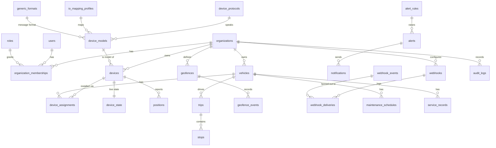

# Database

PostgreSQL 16 with PostGIS 3 and TimescaleDB 2.17. Migrations (Django) create everything, including hypertables,
policies, Row-Level Security and the restricted role's grants.

## Roles

| Role | Used by | Rights |
| --- | --- | --- |
| owner (`DATABASE_USER`, e.g. `gps`) | migrations, Celery, gateway, processor | owns the schema; bypasses RLS (owner) |
| `gps_app` | web requests (`DB_RUNTIME_ROLE=gps_app`) | DML on tenant tables under RLS; read-only on reference tables; no direct access to `positions` or `positions_hourly` |

Every request sets `app.current_org` with `SET LOCAL` inside its transaction; RLS policies compare each row's
`organization_id` with it. Platform-wide work (Super Admin pages, background tasks that span tenants) sets
`app.bypass_rls = on` for that transaction only (`common/rls.py`).

## Main tables



| Table | Notes |
| --- | --- |
| `positions` | TimescaleDB hypertable on `device_time` (1-day chunks). Unique `(device_id, device_time, record_hash)` for deduplication. Stores `organization_id` and `vehicle_id` as they were at ingestion. Flags `gps_valid`, `is_outlier`, `is_late`. Compressed after 7 days, segmented by device. Retention: the platform maximum by policy, each organization's `retention_days` by a daily task. |
| `positions_hourly` | Continuous aggregate per device and hour (records, valid fixes, late records, moving records, max speed); real-time aggregation; refreshed every 30 min over the last 3 days. |
| `raw_packets` | Hypertable of hex packets when raw logging is on; 14-day retention. |
| `device_state` | One row per device: newest position (never moves back in device time), status, IO, last packet. Written by the gateway and the processor; the live map reads only this. |
| `trips`, `stops`, `idle_events`, `speed_events`, `geofence_events` | Processor results; `delayed` marks results from late data. |
| `processing_checkpoints` | Per-device analysis state and last processed record. |
| `alerts`, `alert_rules`, `notifications`, `notification_preferences` | One open alert per rule, vehicle and type. |
| `webhook_events`, `webhook_deliveries`, `webhooks`, `api_keys` | Outbox, delivery log, endpoints, hashed keys. |
| `organization_settings`, `platform_settings` | Overrides only (`apps/settings_app/schema.py` has the keys and defaults). |
| `generic_formats` | UI-defined tracker formats (JSON or delimited). |
| `audit_logs` | Append-only. |

## Spatial data

Coordinates are WGS 84. Geofences are stored as circles (`center_lat`, `center_lon`, `radius_m`) or polygons
(ring of `[lat, lon]`); distances use PostGIS geography. Indexes: `positions (device_id, device_time DESC)`,
GiST where spatial filters are used.

## Inspecting

```bash
docker compose exec postgres psql -U gps -d gps
SELECT hypertable_name, num_chunks FROM timescaledb_information.hypertables;
SELECT * FROM timescaledb_information.jobs;                 -- compression, retention, aggregate refresh
SELECT pg_size_pretty(pg_database_size('gps'));
```
