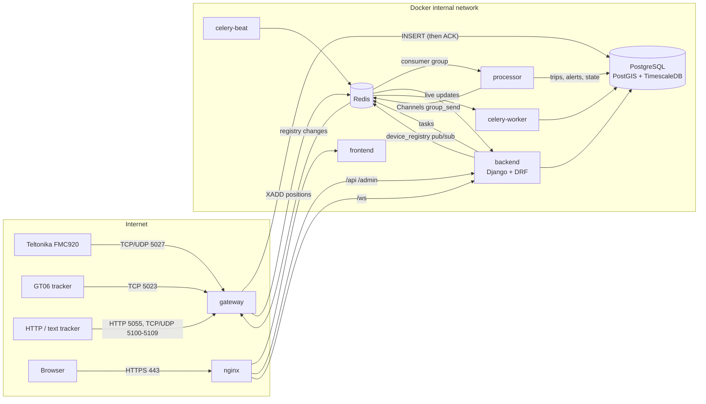
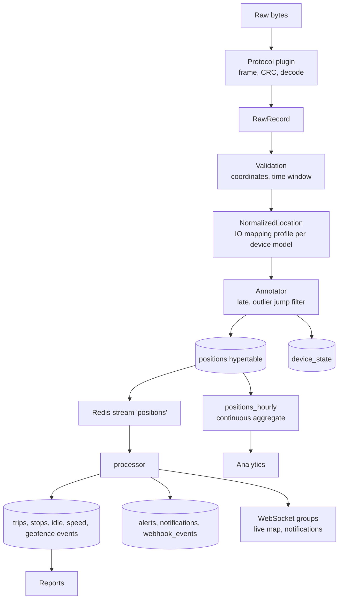
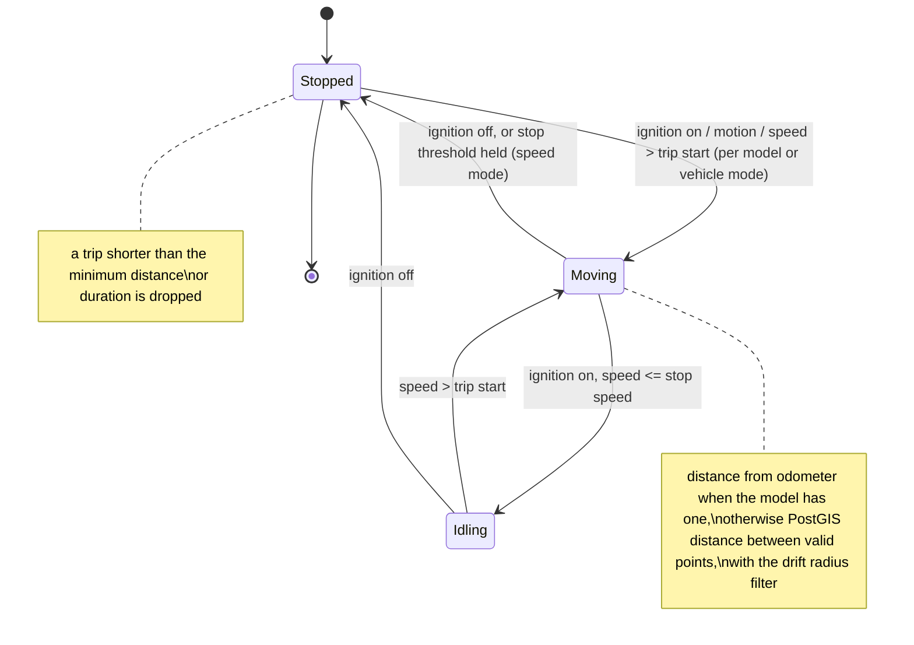
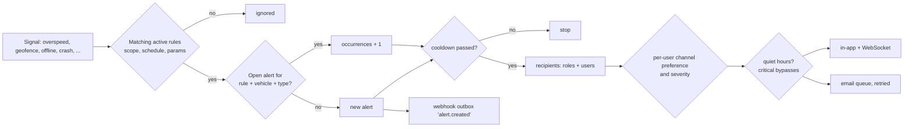
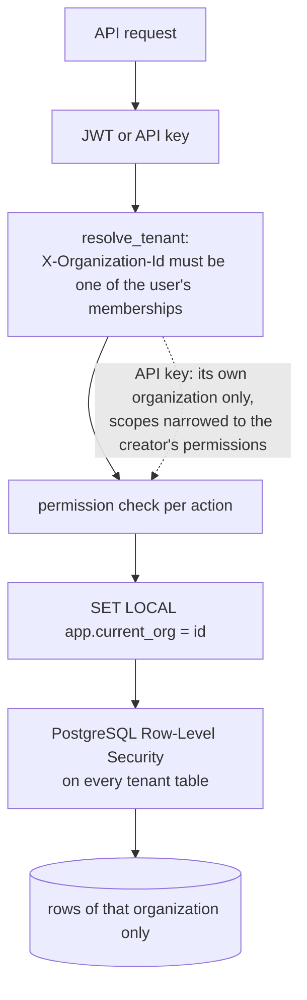
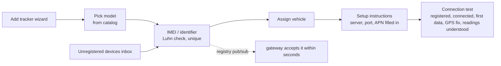
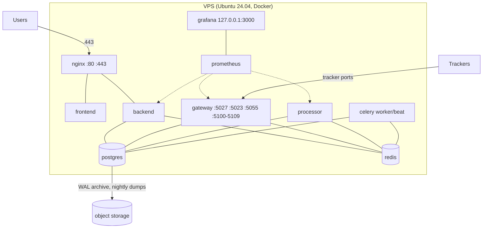

# System architecture

This describes the platform as built. The requirements are in `MASTER_SPEC.md`; why things are the way they are is
in `DECISIONS.md`.

## Services

| Service | Technology | Role | Ports |
| --- | --- | --- | --- |
| `nginx` | Nginx 1.27 | TLS, security headers, rate limits, routes `/api`, `/ws`, `/admin`, `/static`, the web app | 80, 443 (public) |
| `frontend` | React 18 + TypeScript, built to static files | Web app (English and Kiswahili) | internal |
| `backend` | Django 5.2 + DRF + Channels on Uvicorn (ASGI) | REST API, WebSockets, admin, `/health`, `/readiness`, `/metrics` | 8000 internal |
| `celery-worker`, `celery-beat` | Celery 5.6 | Reports, emails, webhooks, maintenance checks, retention, cleanups | none |
| `gateway` | Python asyncio | Tracker connections, protocol plugins, ACK after persistence | 5027 tcp/udp (Teltonika), 5023 tcp (GT06), 5055 http (generic), 5100-5109 reserved; 8081 internal |
| `processor` | Python asyncio | Live status, trips, stops, idling, overspeed, geofences, alerts, webhook events | 8082 internal |
| `postgres` | PostgreSQL 16 + PostGIS 3 + TimescaleDB 2.17 | Source of truth; Row-Level Security per organization | internal only |
| `redis` | Redis 7 (AOF) | Positions stream, pub/sub, Channels layer, Celery broker | internal only |
| `prometheus`, `grafana` | optional profile `monitoring` | Metrics and dashboards | Grafana on 127.0.0.1:3000 |
| `simulator` | optional profile `sim` | Simulated trackers speaking the real protocols | none |



## Device communication (Teltonika)

```mermaid
sequenceDiagram
  participant D as FMC920
  participant G as gateway
  participant P as PostgreSQL
  participant R as Redis
  D->>G: TCP connect, IMEI (2-byte length + ASCII)
  G->>G: registry lookup (cached; invalidated by pub/sub)
  alt registered and active
    G-->>D: 0x01
  else unknown
    G->>P: unregistered-device inbox
    G-->>D: 0x00, close
  end
  loop every send period
    D->>G: AVL packet (Codec 8 / 8E, CRC-16)
    G->>G: decode, validate, normalize, IO mapping, jump filter
    G->>P: one atomic statement: positions (ON CONFLICT DO NOTHING), live state, last seen
    alt committed
      G-->>D: record count (4 bytes)
      G->>R: XADD positions
    else database error
      G--xD: no ACK, close (tracker keeps and resends)
    end
  end
```

GT06 is the same shape: login packet (BCD IMEI) → login ACK; location packets (no ACK in the protocol); heartbeat
and alarm packets ACKed after storage. Generic HTTP trackers get their format's ACK string as the HTTP response
body after storage, or HTTP 503 when storage fails.

## Data flow



## Live tracking

```mermaid
sequenceDiagram
  participant D as Tracker
  participant G as gateway
  participant R as Redis
  participant P as processor
  participant B as backend (Channels)
  participant W as Browser
  W->>B: POST /api/v1/auth/ws-ticket/ (30 s, single use)
  W->>B: WebSocket /ws/tracking/?ticket=...
  B->>B: join group org.{id} (needs tracking.view_live)
  D->>G: packet
  G->>R: XADD positions (after commit)
  R->>P: XREADGROUP
  P->>P: status (moving, idle, stopped, offline, no GPS), analysis
  P->>R: group_send org.{id}
  R->>B: Channels layer
  B->>W: position update (marker moves; measured about 1 s end to end)
```

## Trip detection



Thresholds come from the organization's settings over platform defaults (`apps/settings_app/schema.py`). Late
records (older than what the engine has seen) trigger a recompute of the affected window; results from it are
marked delayed. If records were stored while the stream was lost, the processor reads them from the database
before continuing.

## Alerts



Maintenance and SIM-expiry alerts are raised by Celery with the same semantics (`apps/alerts/system.py`).

## Multi-tenant isolation



Web requests run as the restricted database role `gps_app`, so even a missing filter in code can't read another
tenant's rows. `positions` is reachable only through the `tenant_positions` view; the analytics aggregate only
through `tenant_positions_hourly`. An automated test walks every API route as a user of another organization
(`apps/organizations/tests/test_tenant_isolation.py`).

## Authentication and token refresh

```mermaid
sequenceDiagram
  participant W as Browser
  participant B as backend
  W->>B: POST /auth/login/ (email, password)
  B-->>W: access token (10 min, in memory) + refresh cookie (httpOnly, Secure, SameSite=Strict, path /api/v1/auth/, 7 days)
  W->>B: API calls with Authorization: Bearer access
  B-->>W: 401 when the access token expires
  W->>B: POST /auth/refresh/ (cookie)
  B->>B: rotate: old refresh token revoked; reuse of a revoked one revokes the whole session
  B-->>W: new access token + new refresh cookie
  W->>B: POST /auth/logout/ (session revoked)
```

Failed logins are throttled and lock the account for 15 minutes after 5 failures in 15 minutes. Users see and revoke
their signed-in devices.

## Device onboarding through the UI



New models with a known protocol are added in the catalog (with an IO mapping editor); simple trackers with their
own JSON or text format use **Tracker formats** (no code); a new binary protocol needs a decoder plugin
(`DEVICE_INTEGRATION.md`).

## Deployment



Only 80, 443 and the tracker ports are published. PostgreSQL and Redis are never published.
