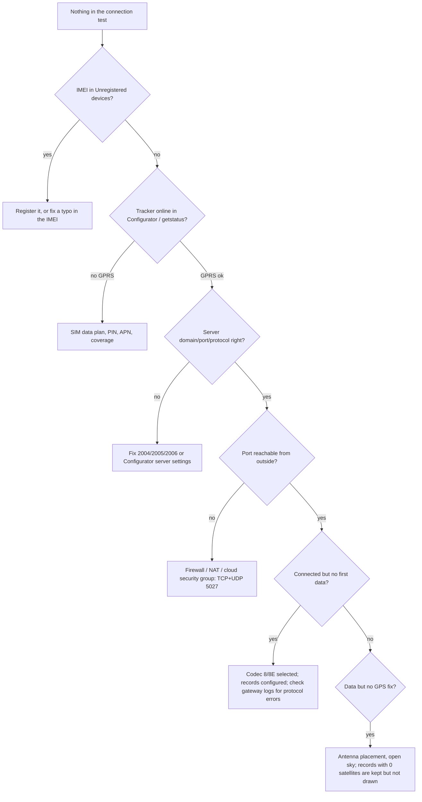

# Teltonika FMC920

> **Verify every parameter ID, SMS command and menu name below against the official Teltonika documentation
> (wiki.teltonika-gps.com) for your firmware version.** They are given as commonly documented for the FMB/FMC
> families; Teltonika changes them between firmware releases.

## What you need

- An FMC920 with power wiring (constant + ignition) installed in the vehicle.
- A nano SIM with an **active data plan**, PIN disabled (or the PIN configured in the tracker), and the carrier's
  APN (Tanzania examples: Vodacom `internet`, Airtel `internet`, Tigo `tigoweb`; check with the carrier).
- Your server's public **domain or IP**, the **port 5027** and the protocol (**TCP** recommended; UDP supported).
- The tracker registered in the platform: **Trackers → Add tracker**, model *Teltonika FMC920*, its 15-digit IMEI
  (on the label and in Configurator), installed in a vehicle. Unregistered trackers are refused and listed under
  **Unregistered devices** (Super Admin).

## Configure with Teltonika Configurator (USB or Bluetooth)

1. **GPRS:** APN name (and user/password if the carrier needs them).
2. **Server settings:** Domain = your `TRACKER_SERVER_HOST`, Port = `5027`, Protocol = TCP.
3. **System → Data protocol:** *Codec 8* or *Codec 8 Extended* (8E carries more IO elements; both are supported).
4. **Data acquisition:** records on moving (e.g. every 10-30 s or 100-300 m or 10-15° heading change) and on stop
   (e.g. every 5-15 min). Send period: how many records to batch before sending (3-5 is typical).
5. **Open Link Timeout:** how long the TCP link stays open after sending. Keep it below the platform's 5-minute idle
   timeout, or the tracker will see the link closed and reconnect (harmless, but wasteful).
6. **I/O:** enable ignition (AIN/DIN1 or virtual ignition), external voltage, battery, GSM signal, movement, and any
   events you need (crash, towing, jamming, overspeeding). The seeded IO profile maps the common ones; check the
   model's **IO mapping** editor in the catalog for what the platform understands.
7. Save to the device.

## Configure by SMS

Format: `<login> <password> <command>`; with no SMS login or password set, start with **two spaces**.

```
  setparam 2001:internet               APN            (verify ID)
  setparam 2004:gps.example.co.tz      server domain  (verify ID)
  setparam 2005:5027                   server port    (verify ID)
  setparam 2006:0                      0 = TCP, 1 = UDP (verify ID)
  getinfo                              runtime information
  getstatus                            modem and GPRS status
  getgps                               current fix
  getver                               firmware version
```

## Check it from the platform

1. Open the tracker's **Connection test**: *registered → connected → first data → GPS fix → readings understood*
   turn green in order. The panel explains what to check for a stage that stays grey.
2. **Diagnostics:** last connection, records received, ingestion lag, decode errors.
3. **Raw packets:** turn on raw logging for the tracker to see each AVL packet in hex with its decode result
   (kept 14 days; turn it off afterwards).
4. **Commands:** `getinfo`, `getgps` and others are queued until the tracker connects; answers appear in the panel.

## No data: what to check



`docker compose logs -f gateway | grep <last 4 digits of IMEI>` shows the gateway's view (IMEIs are masked in logs).
